<div align="center">


**МІНІСТЕРСТВО ОСВІТИ І НАУКИ УКРАЇНИ**

НАЦІОНАЛЬНИЙ ТЕХНІЧНИЙ УНІВЕРСИТЕТ УКРАЇНИ<br>
«КИЇВСЬКИЙ ПОЛІТЕХНІЧНИЙ ІНСТИТУТ<br>
ІМЕНІ ІГОРЯ СІКОРСЬКОГО»

ФАКУЛЬТЕТ БІОМЕДИЧНОЇ ІНЖЕНЕРІЇ

КАФЕДРА БІОМЕДИЧНОЇ КІБЕРНЕТИКИ

# Лабораторна робота № 5

з дисципліни «**Високопродуктивні розподілені обчислювальні системи**»

на тему: «**Проєктування потокобезпечної структури даних**»

</div>

**Виконала:**  
студентка гр. ЗК-61мп  
Бойко Я. Л.

**Перевірив:**  
старший викладач БМК  
Матвійчук О. В.

<div align="center">

Київ – 2026

</div>

---

## Завдання для варіанта №4

|                                            |                                                                                                                  |
|--------------------------------------------|------------------------------------------------------------------------------------------------------------------|
| **Структура**                              | С4. Пріоритетна черга задач місткістю 64                                                                         |
| **Кількість потоків n**                    | 12                                                                                                               |
| **Потоки запису n<sub>w</sub> = ⌈n / 2⌉**  | 6 (потоки 1, 3, 5, 7, 9, 11)                                                                                     |
| **Потоки читання n<sub>r</sub> = ⌊n / 2⌋** | 6 (потоки 2, 4, 6, 8, 10, 12)                                                                                    |
| **Операція запису**                        | push(p, x), після якого той самий потік виконує pop()                                                            |
| **Операція читання**                       | peek_max() і size() порівну                                                                                      |
| **Інваріанти для перевірки**               | розмір від 0 до 64; кожен елемент вийнято рівно один раз; peek_max повертає елемент з найбільшим p серед наявних |

## Хід роботи

Усі прогони виконано на одній машині (8 логічних ядер, Python 3.10.8) без інших навантажень. Код стенду і допоміжних скриптів та сирі результати прогонів (results/runs.jsonl, results/x1.jsonl, results/tcs.jsonl) лежать у репозиторії [https://github.com/yana-boiko/lab5](https://github.com/yana-boiko/lab5). У кожному прогоні прогрів триває 1 с, вимір D = 10 с; кожен прогін повторено 3 рази (параметр --rep), у таблицях наведено медіани трьох прогонів.

### Крок 1

Реалізовано пріоритетну чергу задач С4 місткістю 64 як двійкову купу-максимум: масив пар (p, x), де p — пріоритет, x — унікальний ідентифікатор задачі. Готові потокобезпечні колекції не використовувалися, для синхронізації застосовано лише примітиви модуля threading (Lock, Condition). Операції: push(p, x), pop(), peek_max(), size().

Файл stand.py створює порожню чергу (для С4 початкове заповнення в умові не передбачене) і запускає n = 12 потоків з номерами 1–12. Потоки з непарними номерами (n<sub>w</sub> = 6) виконують лише запис: push, після якого той самий потік виконує pop(), тож у черзі одночасно не більше 6 елементів і вона не переповнюється при місткості 64. Потоки з парними номерами (n<sub>r</sub> = 6) виконують лише читання: по черзі peek_max() і size(). Операції йдуть одна за одною без пауз; аргументи (пріоритет — випадкове ціле від 0 до 999, ідентифікатор — унікальне число) генеруються в потоці до виклику операції.

Кожна операція повертає три моменти часу (perf_counter_ns): t<sub>call</sub> — до захоплення замка, t<sub>acq</sub> — після захоплення, t<sub>ret</sub> — після звільнення. Звідси тривалість операції τ = t<sub>ret</sub> − t<sub>call</sub> і час очікування замка t<sub>wait</sub> = t<sub>acq</sub> − t<sub>call</sub>. Враховуються операції, що почалися після прогріву і завершилися до кінця вимірювання. Кожен потік веде власні списки, тому облік не потребує синхронізації. Прийняте рішення: кожен виклик (push, pop, peek_max, size) рахується окремою операцією, тобто N<sub>w</sub> включає і push, і pop.

Після прогону стенд перевіряє: розмір черги від 0 до 64; властивість купи (батьківський елемент не менший за дочірні); жоден елемент не вийнято двічі і множина покладених дорівнює вийнятим плюс залишок (кожен елемент вийнято рівно один раз); окремою послідовною перевіркою peek_max() повертає найбільший p серед наявних, а pop() віддає елементи в порядку спадання p; (з кроку 3) операції читання не змінюють структуру.

Стенд друкує кількість операцій кожного потоку, X<sub>w</sub>, X<sub>r</sub>, p50 і p99 тривалості операцій кожної ролі, найбільший t<sub>wait</sub> запису, частки очікування w<sub>w</sub> і w<sub>r</sub>. Спосіб синхронізації вибирається параметром --sync (global або rw). Окремий режим --mode x1 вимірює X<sub>1</sub>: один потік по черзі виконує push, pop, peek_max, size (пропорція n<sub>w</sub> : n<sub>r</sub> = 6 : 6 = 1 : 1) під тим самим замком. Команди:

```bash
python stand.py --sync global --rep 1
python stand.py --sync global --mode x1
```

<p align="center">
  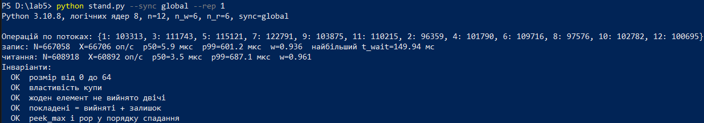<br>
  <em>Рисунок 1 – Тестовий прогін стенду з глобальним замком (n = 12): операції потоків, Xw, Xr, p50, p99, інваріанти</em>
</p>

<p align="center">
  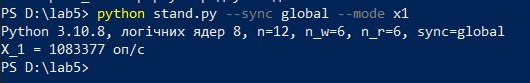<br>
  <em>Рисунок 2 – Вимір X1 (тестовий запуск)</em>
</p>

**Таблиця 1. Стенд**

| **n** | **nw** | **nr** | **Мова і версія** | **Логічних ядер** | **X1, оп/с**                                   | **Інваріанти після прогонів кроків 2 і 3**      |
|-------|--------|--------|-------------------|-------------------|------------------------------------------------|-------------------------------------------------|
| 12    | 6      | 6      | Python 3.10.8     | 8                 | 1 126 799 (глобальний замок); 476 796 (RWLock) | Усі інваріанти виконано у прогонах кроків 2 і 3 |

### Крок 2

Усі операції (push, pop, peek_max, size) захоплюють один і той самий threading.Lock на весь час роботи зі структурою – як запис, так і читання (клас GlobalLock). Умовні змінні не потрібні: pop() викликається лише після власного push(), а черга не заповнюється понад 6 елементів із 64, тому операцій, що чекають на порожню чи повну чергу, немає.

Три прогони на 12 потоках; у таблицю 2 записано медіани. Команди:

```bash
python stand.py --sync global --rep 1 (далі --rep 2, --rep 3)
python table2.py
```

Режим --mode tcs: один потік без конкуренції виконує push, pop, peek_max, size і для кожної операції вимірює t<sub>ret</sub> − t<sub>acq</sub>. Тоді t<sub>cs,w</sub> – середнє за push і pop, t<sub>cs,r</sub> – середнє за peek_max і size. Це вимірювання трохи завищує час утримання, бо в нього входять виклик release і виклик perf_counter_ns. Медіани трьох вимірів: t<sub>cs,w</sub> = 0,426 мкс, t<sub>cs,r</sub> = 0,241 мкс. Середній час утримання t̄<sub>cs</sub> = (n<sub>w</sub> · t<sub>cs,w</sub> + n<sub>r</sub> · t<sub>cs,r</sub>) / n = (6 · 0,426 + 6 · 0,241) / 12 = 0,3334 мкс; межа пропускної здатності 1 / t̄<sub>cs</sub> = 1 / (0,3334 · 10⁻⁶ с) ≈ 2,999 · 10⁶ оп/с. Команда:

```bash
python stand.py --sync global --mode tcs --rep 1 (далі --rep 2, --rep 3)
```

<p align="center">
  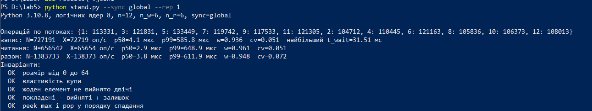<br>
  <em>Рисунок 3 – Глобальний замок, прогін 1 (n = 12)</em>
</p>

<p align="center">
  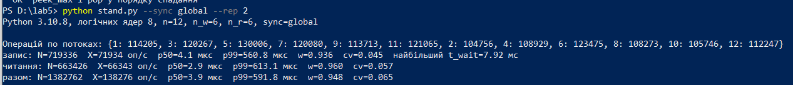<br>
  <em>Рисунок 4 – Глобальний замок, прогін 2</em>
</p>

<p align="center">
  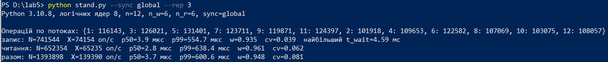<br>
  <em>Рисунок 5 – Глобальний замок, прогін 3</em>
</p>

<p align="center">
  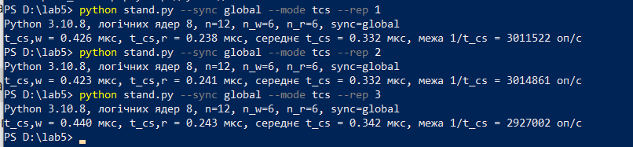<br>
  <em>Рисунок 6 – Вимір tcs,w і tcs,r (три повтори)</em>
</p>

<p align="center">
  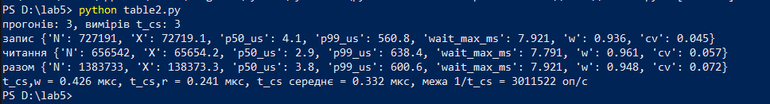<br>
  <em>Рисунок 7 – Медіани трьох прогонів і tcs (скрипт table2.py)</em>
</p>

**Таблиця 2. Глобальний замок**

| **Роль** | **Операцій за D** | **X, оп/с** | **p50, мкс** | **p99, мкс** | **Найбільший twait, мс** | **w** | **cv** | **tcs, мкс**    |
|----------|-------------------|-------------|--------------|--------------|--------------------------|-------|--------|-----------------|
| Запис    | 727 191           | 72 719      | 4,1          | 560,8        | 7,92                     | 0,936 | 0,045  | 0,426           |
| Читання  | 656 542           | 65 654      | 2,9          | 638,4        | 7,79\*                   | 0,961 | 0,057  | 0,241           |
| Разом    | 1 383 733         | 138 373     | 3,8          | 600,6        | —                        | 0,948 | 0,072  | 0,333 (середнє) |

З глобальним замком 12 потоків виконують 138 373 оп/с (запис 72 719, читання 65 654). Типова операція дуже швидка (p50 = 3,8 мкс), але хвіст розподілу важкий: p99 = 600,6 мкс, тобто в ≈160 разів більше за медіану. Частка часу очікування w = 0,948 – потоки майже весь час чекають на замок. Рівномірність між потоками добра (cv = 0,072; кількість операцій потоків лежить у межах 105–131 тис.), найбільший t<sub>wait</sub> запису 7,92 мс набагато менший за D = 10 с, тож голодування писців немає.

### Крок 3

RWLock написано на threading.Condition (клас RWLock у stand.py). Стан замка – лічильник активних читачів readers і прапорець writing. Читач чекає, лише поки йде запис; писець чекає, доки немає ні читачів, ні іншого писця. Внутрішній замок Condition береться лише на час зміни стану, а сама робота з купою відбувається поза ним, тому читачі можуть працювати одночасно. Операції запису захоплюють замок у режимі запису, операції читання – у режимі читання.

```python
class RWLock:
    def __init__(self):
        self.c = threading.Condition(threading.Lock())
        self.readers = 0
        self.writing = False

    def acquire_read(self):
        with self.c:
            while self.writing:
                self.c.wait()
            self.readers += 1

    def release_read(self):
        with self.c:
            self.readers -= 1
            if self.readers == 0:
                self.c.notify_all()

    def acquire_write(self):
        with self.c:
            while self.writing or self.readers > 0:
                self.c.wait()
            self.writing = True

    def release_write(self):
        with self.c:
            self.writing = False
            self.c.notify_all()
```

Перевага читачів без черги: поки є активні читачі, нові читачі входять без очікування, навіть якщо писець уже чекає; писець отримує замок лише тоді, коли читачів немає. Справедливості замок не гарантує, тому голодування писця теоретично можливе – його ознаками є найбільший t<sub>wait</sub> запису і cv. При звільненні замка прокидаються всі очікувачі (notify_all).

За кодом: peek_max() лише читає self.h\[0\], size() лише читає len(self.h), присвоєнь полів структури в них немає. Додатково стенд перевіряє це тестом: після 1000 викликів peek_max() і size() купа збігається зі знімком, зробленим до викликів. Інваріант «читання не змінюють структуру» має статус OK у всіх прогонах з RWLock (рисунки 8–10).

Три прогони на 12 потоках, а також по три вимірювання X<sub>1</sub> для обох замків (потрібні для таблиці 5, бо X<sub>1</sub> береться «під тим самим замком»). Команди:

```bash
python stand.py --sync rw --rep 1 (далі --rep 2, --rep 3)
python stand.py --sync global --mode x1 --rep 1 (далі 2, 3)
python stand.py --sync rw --mode x1 --rep 1 (далі 2, 3)
python table3.py
```

<p align="center">
  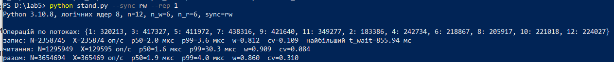<br>
  <em>Рисунок 8 – RWLock, прогін 1 (n = 12)</em>
</p>

<p align="center">
  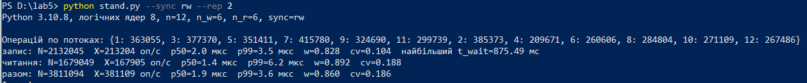<br>
  <em>Рисунок 9 – RWLock, прогін 2</em>
</p>

<p align="center">
  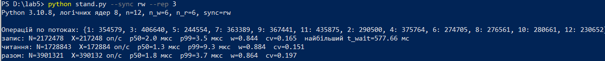<br>
  <em>Рисунок 10 – RWLock, прогін 3</em>
</p>

<p align="center">
  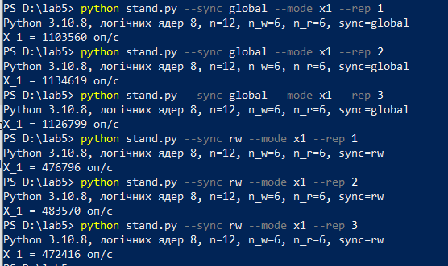<br>
  <em>Рисунок 11 – Вимірювання X1 для глобального замка і RWLock (по три запуски)</em>
</p>

<p align="center">
  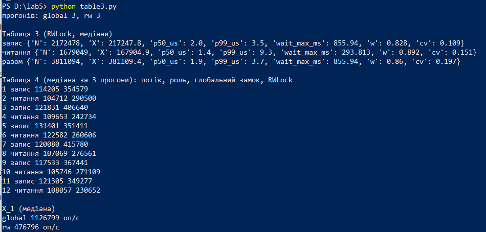<br>
  <em>Рисунок 12 – Медіани для таблиць 3 і 4 та X1 (скрипт table3.py)</em>
</p>

**Таблиця 3. RWLock**

| **Роль** | **Операцій за D** | **X, оп/с** | **p50, мкс** | **p99, мкс** | **Найбільший twait, мс** | **w** | **cv** |
|----------|-------------------|-------------|--------------|--------------|--------------------------|-------|--------|
| Запис    | 2 172 478         | 217 248     | 2,0          | 3,5          | 855,94                   | 0,828 | 0,109  |
| Читання  | 1 679 049         | 167 905     | 1,4          | 9,3          | 293,81\*                 | 0,892 | 0,151  |
| Разом    | 3 811 094         | 381 109     | 1,9          | 3,7          | —                        | 0,860 | 0,197  |

**Таблиця 4. Операції потоків за D секунд**

| **Потік** | **Роль** | **Глобальний замок** | **RWLock** |
|-----------|----------|----------------------|------------|
| 1         | запис    | 114 205              | 354 579    |
| 2         | читання  | 104 712              | 290 500    |
| 3         | запис    | 121 831              | 406 640    |
| 4         | читання  | 109 653              | 242 734    |
| 5         | запис    | 131 401              | 351 411    |
| 6         | читання  | 122 582              | 260 606    |
| 7         | запис    | 120 080              | 415 780    |
| 8         | читання  | 107 069              | 276 561    |
| 9         | запис    | 117 533              | 367 441    |
| 10        | читання  | 105 746              | 271 109    |
| 11        | запис    | 121 305              | 349 277    |
| 12        | читання  | 108 057              | 230 652    |

З RWLock сумарна пропускна здатність становить 381 109 оп/с (запис 217 248, читання 167 905), тобто в 2,75 раза більше, ніж з глобальним замком. Хвіст тривалості майже зник: p99 дорівнює 3,5 мкс для запису і 9,3 мкс для читання (було 561 і 638 мкс), p50 зменшився вдвічі. Частка очікування знизилась до 0,860. Кількість операцій у кожного потоку зросла в 2,1–3,5 раза.

Водночас доступ став нерівнішим: cv зріс з 0,072 до 0,197 (потоки запису виконують 349–416 тис. операцій, потоки читання 231–291 тис.). Найбільший t<sub>wait</sub> запису збільшився з 7,9 мс до 856 мс, що є наслідком політики з перевагою читачів: поки зайнято читачами, писець іноді чекає довго. Це 8,6 % від D = 10 с, тож повного голодування писців немає.

### Крок 4

За формулами з умови за таблицями 1–3 розраховано метрики прискорення (скрипт table5.py; нових прогонів не потрібно). Використано n = 12, медіани X з таблиць 2 і 3, X<sub>1</sub> з таблиці 1 (окремо для кожного замка) та t̄<sub>cs</sub> = 0,3334 мкс. S(n) = X / X<sub>1</sub>, E(n) = S(n) / n, S<sub>w</sub>, S<sub>r</sub>, S<sub>Σ</sub> – відношення X<sub>w</sub>, X<sub>r</sub>, X з RWLock до тих самих величин з глобальним замком; ρ = X(G) · t̄<sub>cs</sub>.

<p align="center">
  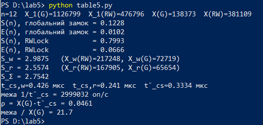<br>
  <em>Рисунок 13 – Розрахунок метрик прискорення (скрипт table5.py)</em>
</p>

**Таблиця 5. Метрики прискорення**

| **Метрика**                         | **Формула**    | **Значення**                  |
|-------------------------------------|----------------|-------------------------------|
| S(n), глобальний замок              | X(G) / X1      | 138 373 / 1 126 799 = 0,123   |
| E(n), глобальний замок              | S(n) / n       | 0,1228 / 12 = 0,0102          |
| S(n), RWLock                        | X(RW) / X1     | 381 109 / 476 796 = 0,799     |
| E(n), RWLock                        | S(n) / n       | 0,7993 / 12 = 0,0666          |
| Sw                                  | Xw(RW) / Xw(G) | 217 248 / 72 719 = 2,99       |
| Sr                                  | Xr(RW) / Xr(G) | 167 905 / 65 654 = 2,56       |
| SΣ                                  | X(RW) / X(G)   | 381 109 / 138 373 = 2,75      |
| ρ, завантаженість глобального замка | X(G) · t̄cs     | 138 373 · 0,3334·10⁻⁶ = 0,046 |

S(n) \< 1 для обох способів синхронізації (0,123 для глобального замка і 0,799 для RWLock): 12 потоків дають меншу пропускну здатність, ніж один потік, а ефективність E дуже мала (0,010 і 0,067). Причина в тому, що потоки Python виконуються через GIL, тому додаткові потоки не дають паралельного обчислення, а лише додають витрати на синхронізацію і перемикання потоків. X<sub>1</sub> для RWLock (476 796 оп/с) у 2,4 раза менший, ніж для глобального замка (1 126 799 оп/с): навіть без конкуренції кожна операція двічі бере внутрішній замок Condition. Через різні X<sub>1</sub> значення S(n) двох замків не можна порівнювати напряму, пряме порівняння дає S<sub>Σ</sub> = 2,75.

RWLock прискорив обидві ролі: запис у S<sub>w</sub> = 2,99 раза, читання в S<sub>r</sub> = 2,56 раза; сумарно в 2,75 раза.

Порівняння X(G) з межею 1 / t̄<sub>cs</sub>. Межа становить ≈ 3,0 · 10⁶ оп/с, а виміряне X(G) = 138 373 оп/с, тобто лише ≈ 4,6 % межі (межа більша в 21,7 раза). Завантаженість глобального замка ρ = 0,046, далека від 1. Отже, пропускну здатність обмежує не тривалість критичної секції: замок вільний понад 95 % часу, але потоки проводять в очікуванні 94,8 % часу (w = 0,948). Імовірно, втрати зумовлені передачею замка між потоками і перемиканням потоків через GIL – це гіпотеза, що узгоджується з даними. Оскільки t̄<sub>cs</sub> виміряно із завищенням, реальне ρ ще менше.

### Крок 5

Таблицю 6 складено скриптом table6.py з медіан прогонів кроків 2 і 3. x – швидкість одного потоку ролі (X ролі, поділена на 6); h = p99 / p50; φ – частка ролі в усіх операціях (X ролі / X у кожному прогоні, далі медіана, тому φ запису і читання в сумі дають 1). Відношення RW / G обчислено діленням значення з RWLock на значення з глобальним замком (нульових значень немає, тому різниця не використовувалась). Команда:

```bash
python table6.py
```

<p align="center">
  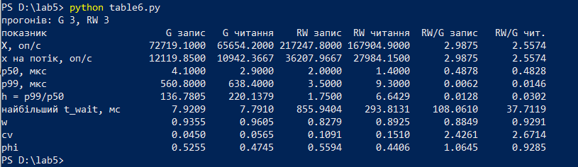<br>
  <em>Рисунок 14 – Порівняння доступу до даних (скрипт table6.py)</em>
</p>

**Таблиця 6. Порівняння доступу до даних**

| **Показник**                    | **Глобальний замок: запис** | **Глобальний замок: читання** | **RWLock: запис** | **RWLock: читання** | **RW / G: запис** | **RW / G: читання** |
|---------------------------------|-----------------------------|-------------------------------|-------------------|---------------------|-------------------|---------------------|
| X, оп/с                         | 72 719                      | 65 654                        | 217 248           | 167 905             | 2,99              | 2,56                |
| x, на один потік ролі, оп/с     | 12 120                      | 10 942                        | 36 208            | 27 984              | 2,99              | 2,56                |
| p50, мкс                        | 4,1                         | 2,9                           | 2,0               | 1,4                 | 0,49              | 0,48                |
| p99, мкс                        | 560,8                       | 638,4                         | 3,5               | 9,3                 | 0,0062            | 0,0146              |
| h = p99 / p50                   | 136,8                       | 220,1                         | 1,75              | 6,64                | 0,0128            | 0,0302              |
| Найбільший twait, мс            | 7,92                        | 7,79                          | 855,94            | 293,81              | 108,1             | 37,7                |
| w                               | 0,936                       | 0,961                         | 0,828             | 0,892               | 0,885             | 0,929               |
| cv                              | 0,045                       | 0,057                         | 0,109             | 0,151               | 2,43              | 2,67                |
| φ, частка ролі в усіх операціях | 0,526                       | 0,474                         | 0,559             | 0,441               | 1,06              | 0,93                |

Для якої ролі швидкість доступу збільшилась. Для обох: запис у 2,99 раза (36,2 проти 12,1 тис. оп/с на потік), читання в 2,56 раза (28,0 проти 10,9 тис. оп/с на потік). Запис виграв більше, тому його частка в усіх операціях зросла з 0,526 до 0,559, а частка читання зменшилась з 0,474 до 0,441. Для жодної ролі швидкість не зменшилась.

**З якими полями це пов’язано.**

1\) Частка очікування w зменшилась для обох ролей (запис 0,936 → 0,828, читання 0,961 → 0,892): потоки менше блокуються на замку.

2\) Хвіст тривалості: p50 зменшився вдвічі, p99 – у 160 разів для запису (561 → 3,5 мкс) і в 69 разів для читання (638 → 9,3 мкс); відношення h = p99 / p50 впало з 137 до 1,8 для запису і з 220 до 6,6 для читання. Це поле найсильніше пов’язане зі зростанням швидкості: з глобальним замком кожна операція чекає на єдиний мютекс і час від часу потрапляє в довгу чергу, з RWLock більшість операцій проходять без очікування.

Рівномірність між потоками: cv запису зріс з 0,045 до 0,109, читання з 0,057 до 0,151 (у 2,4 і 2,7 раза). Найбільший t<sub>wait</sub> запису збільшився в 108 разів (7,9 → 856 мс), читання – у 38 разів (7,8 → 294 мс). Це ціна політики з перевагою читачів і відсутності черги: окремі потоки отримують замок частіше за інших, а писець іноді чекає довго. Для цієї задачі виграш у пропускній здатності і хвості затримки значно перевищує втрату рівномірності, але якщо потрібно обмежити найгірше очікування запису, потрібна політика з пріоритетом писців або справедлива черга (не перевірялось).

## Висновки

У ході роботи було реалізовано та протестовано потокобезпечну пріоритетну чергу з двома способами синхронізації: глобальним замком і RWLock. Проведено порівняння їхньої продуктивності, часу очікування, рівномірності доступу потоків та правильності виконання операцій. RWLock показав вищу пропускну здатність і менший час виконання операцій, проте доступ потоків став менш рівномірним, а очікування запису в окремих випадках збільшилося. Також встановлено, що на результати впливає GIL у Python, який обмежує паралельне виконання потоків. Отже, вибір способу синхронізації залежить не лише від швидкості, а й від характеру навантаження та балансу між потоками.
